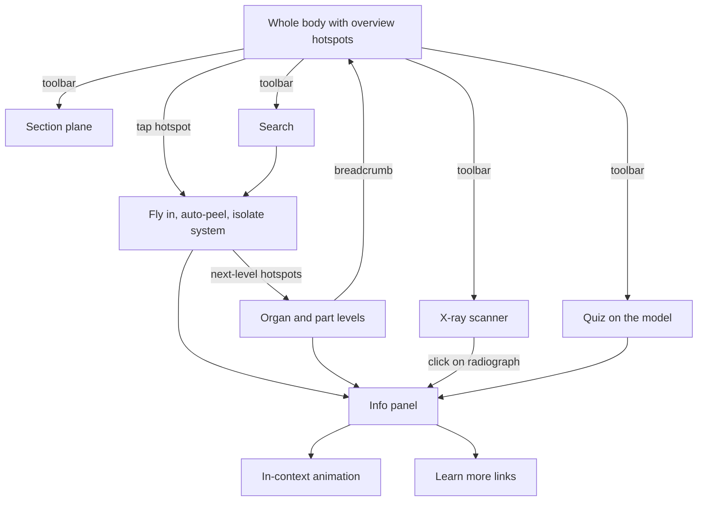
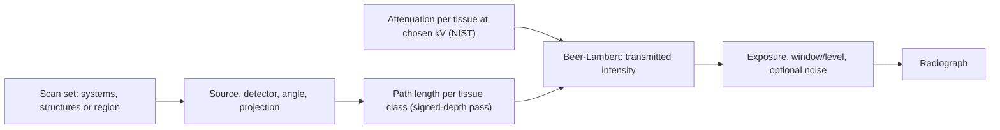
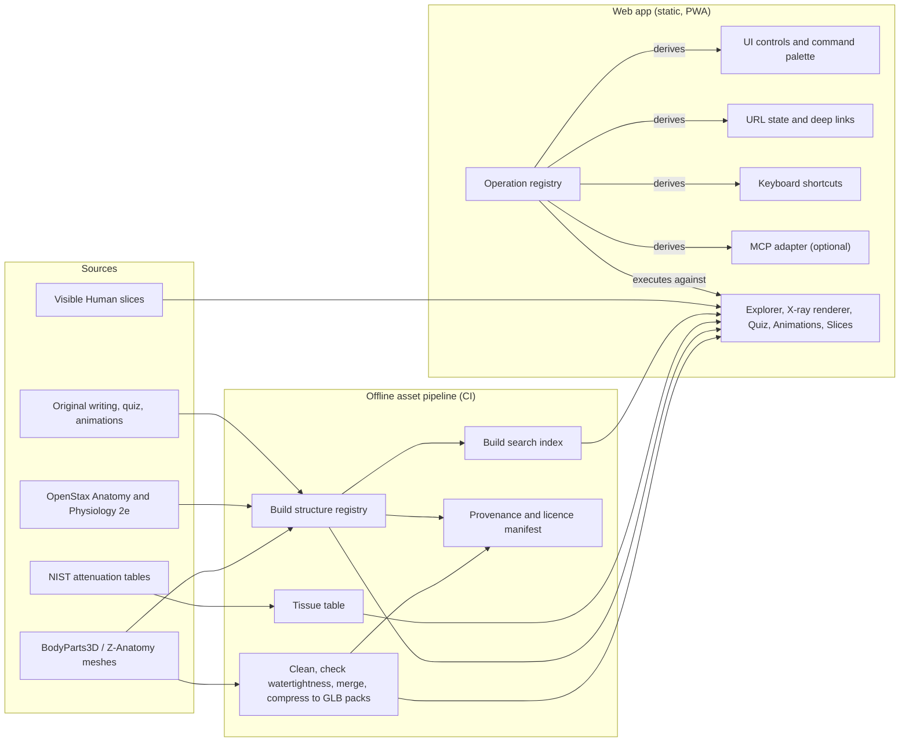

# Somatlas: Product Requirements Document

| | |
|---|---|
| **Name** | Somatlas (from Greek *soma*, "body", plus *atlas*) |
| **Domains** | somatlas.org (canonical), somatlas.app (redirects to .org) |
| **Status** | Draft v0.3 |
| **Owner** | Brice |
| **Date** | 17 October 2026 |

**Changes since v0.2**

- The project is named **Somatlas**, replacing the working title "Body Atlas" (decision D5). The canonical domain is somatlas.org, and somatlas.app redirects to it.

**Changes since v0.1**

- The original is now **inspiration, not a template**. The experience no longer emulates it 1:1.
- **One body model is the whole interface.** The lab hub and the separate Systems Scanner are gone. System detail is reached through hotspots on the model.
- **Family mode is removed.** Anatomy is shown complete and uncensored.
- **The X-ray scanner is a computed radiograph.** The user chooses what to scan and from which angle, and the image is calculated from the anatomy models.
- **The project is free and non-commercial.** The licensing sections are updated to match.
- A decisions log (§5) has been added.

---

## 1. Summary

Somatlas is a free, browser-based, interactive 3D atlas of the human body, inspired by DK's *The Ultimate Human Body 2.0* (1996–97) and built from scratch with open data and original content.

The whole experience is **one explorable body**:

- You rotate it, peel its layers and cut through it.
- Hotspots lead you from the whole body down to systems, organs and their parts.
- A **computed X-ray scanner** lets you place a virtual X-ray source anywhere, choose exactly which structures to scan, and see a radiograph calculated from the models in real time.
- Process animations, a quiz and search all work on the same model.

It runs in desktop and mobile browsers with no install, works offline once loaded, and every view can be shared by URL.

---

## 2. Background: what the original did

From 1997 reviews and DK's own product copy (see References):

- **Lab hub.** The program opened in a virtual medical lab. The camera moved between three bodies on lab tables, each one a "scanner".
- **Systems scanner.** Browse 10 body systems and their organs.
- **3D scanner.** Rotate the body through 360°, view cutaways, and peel away layers to examine the organs, circulatory system and skeleton. You could show the skeleton, the organs, or both, and combine body systems to see how they interact. There was also a body "flythrough".
- **X-ray scanner.** The skeleton as an X-ray would show it.
- **Body Quiz Challenge.** 15 questions. Each right answer moved a marker down a body silhouette from brain to feet via the circulatory system.
- **Body Online.** A companion website (health journal, surveys, links) reached via a spinning globe.
- **Content volume.** About 100,000 words, 170 animations, 1,030 illustrations, 25 new video sequences, 1,500 sounds, and 745 screens and pop-ups. Animations covered, for example, the heart and lungs during exercise, blood circulation, digestion and DNA replication.
- **MMX edition.** Full-screen video at 25 fps.

We keep the *capabilities* of the original and drop its *structure*. In 1997, separate scanner "rooms" made sense; today a single real-time model can do everything directly.

**Why this is feasible now:** open 3D anatomy keyed to a standard ontology (BodyParts3D, Z-Anatomy), open textbook content (OpenStax), published X-ray attenuation data (NIST), and mature browser 3D (WebGL2, glTF) make it achievable as a static web app.

---

## 3. Goals, principles and non-goals

### Goals

- **G1. Coverage.** Every capability of the original is available, reinterpreted for direct manipulation of one model (see §6).
- **G2. Free exploration.** No modes to learn. Everything starts from, and returns to, the body.
- **G3. Clean room.** Use no DK code, art, text, audio, video, names or trade dress.
- **G4. Reach.** Run in any modern browser on desktop and mobile, with no install and offline use after first load.
- **G5. Shareable state.** Every view (camera, layers, selection, section plane, X-ray setup) can be reproduced from a URL.
- **G6. Open and attributable.** Every asset has a known source and licence, and licence obligations are met.
- **G7. Architecture.** Follow "define once, derive interfaces" (see §10).

### Content principle

Anatomy is shown **complete and uncensored**, including reproductive anatomy, and presented in a neutral, educational register. There is no censorship or "family" toggle.

### Non-goals (v1)

- A 1:1 recreation of the original's structure (lab hub, separate scanner screens, 2D system maps).
- Clinical or professional-grade anatomy. This is an educational explorer, not a medical reference.
- Medically accurate radiography. The X-ray scanner is a physically *inspired* teaching tool, not a diagnostic simulator.
- Diagnosis, symptom checking or health advice.
- User accounts, cloud sync or multi-user features.
- Native apps. The product ships as a PWA only.
- Any commercial use (see D1).

---

## 4. Users

| Persona | Need |
|---|---|
| Curious adult or nostalgic fan of 90s edutainment (primary for v1) | Explore the body freely; peel, spin, cut and X-ray it |
| Secondary-school student (KS3 to GCSE biology) | Find a structure fast, see where it sits, read a short accurate explanation, self-test |
| Parent exploring with a child | Simple navigation and engaging animations |
| Teacher (later) | Free, linkable views to drop into lessons |

---

## 5. Decisions log

| ID | Decision | Consequence |
|---|---|---|
| D1 | The project is **free and non-commercial**: no ads, paid tiers or sponsorship placements. | Non-commercial-licensed models may be used (§9). Donations are a grey area under NC licences and are undecided (§16). |
| D2 | **One body model is the entry point and the whole interface.** System detail is reached through hotspots on the model. | The lab hub, the separate Systems Scanner and 2D system maps are dropped. |
| D3 | **No family or censorship mode.** | Reproductive anatomy is always included and is labelled and described like any other system. |
| D4 | **The X-ray scanner computes radiographs from the anatomy models**, with a user-chosen scan set, source position and angle. | Meshes must be watertight and tissue-tagged (§8.2); this is checked in the P0 spike. |
| D5 | **The product is named Somatlas.** The canonical domain is somatlas.org; somatlas.app redirects to it. | Avoids the crowded "Body Atlas" name. A coined name has no known clash with existing anatomy products; a UK IPO and EUIPO trade mark check is still to do. |

---

## 6. Coverage of the original

| Original | How it is covered | Phase |
|---|---|---|
| Lab hub with three scanners | **Replaced.** The body model is the entry point; tools sit in a toolbar | — |
| 3D scanner: rotate, layers, cutaway | The core of the explorer: orbit, peel, layers, section plane, isolate | P1 |
| Skeleton, organs, or both | Layer presets and system lenses | P1 |
| Combine systems | Multi-select system lenses | P1 |
| Systems scanner (10 systems) | Overview hotspots for 11 systems; tapping one focuses the model on that system | P1 |
| X-ray scanner | **Extended.** A computed radiograph with free source position and angle, a chosen scan set, exposure controls and contrast agents | P1 / P2 |
| Flythrough | Authored camera paths (for example along the aorta or GI tract) | P3 |
| Animations and video | Process animations launched in context from hotspots and info panels | P2 |
| Body Quiz Challenge (15 questions) | Quiz played on the same model, generated plus authored questions, progress "journey" | P2 |
| Body Online | "Learn more" links per structure and system | P2 |
| Sounds | Per-term pronunciation audio | P2 |
| *(new)* | Search, deep links, offline use, accessibility | P1–P3 |

---

## 7. Experience model

### 7.1 One body, progressive disclosure

The app opens on the whole body with the skin layer visible and a small set of **overview hotspots**, one per organ system (for example the brain, heart, lungs, stomach, kidneys, thyroid, a knee joint and a thigh muscle). From there, **semantic zoom** reveals detail one level at a time:

| Level | What is shown | Example hotspots |
|---|---|---|
| L0 Body | Whole body, one hotspot per system | Heart (cardiovascular), lungs (respiratory) |
| L1 System or region | The system isolated, with the rest of the body ghosted for context | Aorta, venae cavae, heart |
| L2 Organ | One organ in focus | Left ventricle, mitral valve |
| L3 Part | Fine structure where the data supports it | Chordae tendineae |

**Tapping a hotspot:**

1. The camera flies to the structure.
2. Layers above it peel away automatically, following the layer stack in §11.
3. Its system is isolated and the rest of the body is ghosted.
4. The info panel opens.
5. The next level's hotspots appear.

A breadcrumb (*Body › Cardiovascular › Heart › Left ventricle*) steps back out. Any visible mesh can also be clicked directly; hotspots are signposts, not the only way in.

A compact **toolbar** is always available: Layers, Section, X-ray, Search, Quiz. Power users can open the layer drawer and system lenses directly instead of navigating through hotspots.

### 7.2 Interaction flow



---

## 8. Requirements

Priority: **M** = must, **S** = should, **C** = could.

### 8.1 Body explorer

| ID | Pri | Requirement |
|---|---|---|
| EXP-1 | M | Orbit, pan and zoom by mouse, touch (pinch, two-finger drag) and keyboard. Reset view. Preset views: anterior, posterior, left, right, superior. |
| EXP-2 | M | Hotspots at levels L0–L2 (§7.1), derived from the structure registry. They avoid overlapping each other on screen, scale for touch targets, and are reachable as a keyboard-focusable list. |
| EXP-3 | M | Tapping a hotspot flies the camera in, auto-peels the layers above the target, isolates its system with the rest ghosted, opens the info panel and reveals the next level's hotspots. |
| EXP-4 | M | A breadcrumb shows the current level, and each step can be clicked to zoom back out. |
| EXP-5 | M | Click or tap any visible structure to select it; hover labels on pointer devices. |
| EXP-6 | M | Isolate, hide or ghost the selected structures. |
| EXP-7 | M | Layer drawer: toggle each layer (§11), with per-layer opacity and a peel slider that removes layers from the outside in. |
| EXP-8 | M | System lenses: one tap shows a system (or several combined) with everything else ghosted. Presets: Skeleton, Organs, Skeleton + organs, Circulation. |
| EXP-9 | M | Section plane (axial, coronal, sagittal or free) that can be dragged to sweep through the body, with capped cross-section surfaces. |
| EXP-10 | S | Structure tree: a searchable hierarchy by system and region, fully keyboard navigable. |
| EXP-11 | S | L3 hotspots where the mesh data supports them. |
| EXP-12 | C | Flythroughs along authored paths, with captions. |
| EXP-13 | C | User-placed pins and annotations, shareable via URL. |
| EXP-14 | C | Slice viewer: Visible Human CT, MRI and cryosection images browsed by level alongside the section plane. Shown side by side, not overlaid, because it is a different body. |

### 8.2 X-ray scanner (computed radiograph)

The user sets up an exposure much like a radiographer would, but with complete freedom: any angle, any subset of anatomy, any exposure. The image is calculated from the models.

**Scan setup**

| ID | Pri | Requirement |
|---|---|---|
| XR-1 | M | **Scan set.** Choose what is included: the whole body, one or more systems, individual structures, or everything inside a region box. Excluded structures contribute nothing to the image. |
| XR-2 | M | **Source and detector placement.** Drag a virtual X-ray source to any position around the body; the detector follows on the opposite side. Presets: PA, AP, lateral and oblique. |
| XR-3 | M | **Live preview.** A 3D view shows the source, the beam and the detector against the body, next to the radiograph, and both update together. |
| XR-4 | S | **Projection.** Point-source (cone-beam) projection with an adjustable source-to-detector distance, which controls magnification and edge blur; also a parallel-beam option. |
| XR-5 | S | **Collimation.** Restrict the beam to a rectangle on the detector. |

**Exposure and image**

| ID | Pri | Requirement |
|---|---|---|
| XR-6 | M | **Exposure controls.** A kV control changes tissue contrast through energy-dependent attenuation. Brightness (mAs) and window/level controls adjust the displayed image. |
| XR-7 | M | **Responsiveness.** The image updates at interactive rates while the source is moving (§8.8), and renders at full resolution when movement stops. |
| XR-8 | S | **Contrast agents.** Mark the vessels or GI tract as filled with contrast (iodine or barium) to produce angiogram-style and barium-swallow-style images. |
| XR-9 | S | **Identify a shadow.** Clicking a point on the radiograph lists the structures that contribute most attenuation along that ray, each linking to its info panel. |
| XR-10 | S | **Export.** Save the radiograph as PNG with orientation markers and an attribution footer. |
| XR-11 | C | **Realism options.** Quantum noise, simple scatter blur and a polychromatic spectrum, for a more film-like image. |

**Implementation approach (to validate in P0)**

- **Physics.** For each detector pixel, transmitted intensity follows Beer–Lambert:

  *I = I₀ · exp(−Σ μᵢ(E) · Lᵢ)*

  where *Lᵢ* is the path length of the ray through tissue class *i*, and *μᵢ(E)* is that tissue's linear attenuation coefficient at the chosen energy.
- **Attenuation data.** Mass attenuation coefficients and densities come from NIST's tables for ICRU-44 tissues: adipose, blood, cortical bone, brain, lung, skeletal muscle, soft tissue and water. Iodine and barium values come from the same tables.
- **Path length on the GPU.** One additive pass over the scan-set meshes, rendered into floating-point targets with one channel per tissue class. Front-facing fragments subtract their distance from the source and back-facing fragments add it, so each channel ends up holding the total path length through that tissue. Six to eight tissue classes fit in two RGBA targets.
- **Nested volumes.** Structures sit inside an enclosing body volume. Each contributes its attenuation *relative to* the volume that encloses it (μ_structure − μ_enclosing) so tissue is not double-counted. This matters most for the lungs (mostly air) and bone.
- **Precision.** Use 32-bit float targets where float blending is supported, otherwise 16-bit. A WebGPU compute path is an optional enhancement.
- **Known approximations.** Uniform density per structure, with no cortical/trabecular split at first. A monoenergetic beam by default. No scatter unless XR-11 is enabled.
- **Mesh requirements.** Meshes in the scan set must be closed, consistently wound and free of large overlaps. The asset pipeline checks this and records a tissue class on every mesh.
- **Shadow identification (XR-9).** Cast the clicked ray through a BVH of the scan set on the CPU, and rank structures by μ · L.



### 8.3 Structure info panel and content

| ID | Pri | Requirement |
|---|---|---|
| INF-1 | M | Name (English, plus Latin and synonyms where available), system, region, part-of breadcrumb, a 1–3 paragraph description, and sources. |
| INF-2 | S | Pronunciation audio. |
| INF-3 | S | Related items: connected structures, a relevant animation, "X-ray this" (which opens the scanner with this structure's system as the scan set), and "learn more" links. |
| INF-4 | M | Attribution for every asset and text source, plus a credits screen generated from the provenance manifest. |

### 8.4 Process animations

| ID | Pri | Requirement |
|---|---|---|
| ANI-1 | S | Five headline animations at launch: cardiac cycle; breathing at rest versus during exercise; systemic and pulmonary circulation; peristalsis and digestion; DNA replication. |
| ANI-2 | S | Launched in context from the relevant hotspot or info panel, playing on or beside the model. |
| ANI-3 | S | Play, pause and scrub controls, step-by-step captions, and a reduced-motion alternative (stepped stills). |

### 8.5 Quiz

| ID | Pri | Requirement |
|---|---|---|
| QZ-1 | S | Played on the same model. Question types: "tap the …", "identify the highlighted structure", "which system", "what does it do", "which structure casts this X-ray shadow", plus authored questions. |
| QZ-2 | S | 15-question runs, scoped to the whole body or to the current system. |
| QZ-3 | S | Progress shown as a journey through the body, with our own design (for example a blood cell travelling the circulation). |
| QZ-4 | S | Questions generated from the registry plus an authored bank, with difficulty levels. |
| QZ-5 | C | Review mistakes, with links to the structures involved. |

### 8.6 Search, deep links and sharing

| ID | Pri | Requirement |
|---|---|---|
| NAV-1 | M | Instant search over names, synonyms and Latin terms; selecting a result focuses the model as a hotspot tap would. |
| NAV-2 | M | The URL encodes camera, level, visible layers, lenses, section plane, selection and the full X-ray setup. One-tap copy link. |
| NAV-3 | S | Browser back and forward step through view states. |

### 8.7 Learn more

| ID | Pri | Requirement |
|---|---|---|
| LM-1 | S | Curated links per structure and per system (for example the matching OpenStax chapter or NHS Health A–Z page). No user data is collected. |

### 8.8 Cross-cutting (non-functional)

| ID | Requirement |
|---|---|
| NFR-1 | **Explorer performance targets.** First interactive view in ≤ 3 s on broadband desktop and ≤ 6 s on 4G with a mid-range phone. At least 60 fps on desktop and 30 fps on a mid-range phone. Initial download ≤ 5 MB; other system packs stream on demand. |
| NFR-2 | **X-ray performance targets.** At least 30 fps while moving the source, at 1024 × 1024 on a laptop with integrated graphics and 512 × 512 on a mid-range phone. Full-resolution refinement in under 1 s. |
| NFR-3 | **Browsers.** Latest two versions of Chrome, Edge, Firefox and Safari on desktop, iOS and Android. WebGL2 is required; floating-point render targets are used where available. |
| NFR-4 | **Offline.** Installable PWA; cached packs remain available offline. |
| NFR-5 | **Accessibility.** WCAG 2.2 AA for all 2D UI. Full keyboard operation, including hotspots. The structure tree and info panel work well with screen readers. Reduced-motion preference respected (no fly-in animations; instant cuts). System colours are distinguishable without relying on colour alone. |
| NFR-6 | **Privacy.** No accounts and no third-party trackers. Any analytics are anonymous and opt-in. |
| NFR-7 | **Disclaimer.** Educational only, not medical advice; computed radiographs are illustrative, not diagnostic. |
| NFR-8 | **Internationalisation-ready.** Strings externalised and the registry supports multiple languages. English only at launch. |

---

## 9. Content, data and licensing

### 9.1 Sources

| Source | Use | Licence | Notes |
|---|---|---|---|
| **BodyParts3D** (Database Center for Life Science, Japan) | Base meshes; each part keyed by an FMA ID, with part-of relations | CC BY-SA 2.1 Japan | Fixed attribution string required; adaptations must be share-alike. |
| **Z-Anatomy** | Organised and completed version of BodyParts3D, plus definitions | CC BY-SA 4.0 | Includes a few third-party models under non-commercial licences (e.g. inner ear, kidney), which are usable under D1. Definitions lean heavily on Wikipedia (CC BY-SA). Project activity is unclear. |
| **Open 3D Anatomical Model for Education** (Leiden UMC with Utrecht, Maastricht and KU Leuven) | Candidate improved model built on Z-Anatomy | CC BY-SA | Evaluate in P0. |
| **OpenStax *Anatomy and Physiology 2e*** | Source text and figures to adapt for descriptions | CC BY 4.0 | Attribute OpenStax. Some third-party adaptations (e.g. Oregon State's) are CC BY-SA instead. |
| **NIST X-ray mass attenuation coefficients** | Attenuation and density per tissue class, plus iodine and barium | US government data; *check terms* | Only a few dozen values are used. Tissue compositions come from ICRU Report 44. |
| **Visible Human Project** (US National Library of Medicine) | CT, MRI and cryosection slices for the slice viewer | No licence required since 2019; terms and conditions apply | A different body from the BodyParts3D model, so it cannot be overlaid. |
| **Foundational Model of Anatomy (FMA)** | Canonical structure IDs and hierarchy | *Check licence* | Already used as BodyParts3D's key. |
| **Original authored content** | Summaries, quiz questions, animations, UI art | CC BY-SA 4.0 (proposed) | Matches the asset pack, so the whole content side carries one licence. |

### 9.2 Licensing under D1 (non-commercial)

- **Share-alike still applies.** Meshes adapted from BodyParts3D or Z-Anatomy are released under **CC BY-SA 4.0**. Creative Commons permits adaptations of BY-SA 2.x works to be licensed under a later BY-SA version, which is how Z-Anatomy already releases its models.
- **NC-licensed models are allowed but kept separate.** They ship as separate files under their own licence (CC BY-NC-SA or CC BY-NC) and are never merged into BY-SA meshes, because the two share-alike terms cannot both be met in one adaptation.
- **Licence is per-asset metadata.** Every asset records its licence, and two packs are built from the same registry:
  - **Full pack:** the default, which includes NC files, clearly flagged.
  - **BY-SA-only pack:** NC files swapped for their plain BodyParts3D equivalents, for anyone who needs unrestricted reuse.
- **Running the site.** No ads, paid tiers or sponsorship placements. Donations are undecided (§16).
- **Code.** The application code carries its own licence, independent of the asset licences (§16).

---

## 10. Architecture

### 10.1 Principle: define once, derive interfaces

Two registries are the single source of truth.

1. **Structure registry.** Each anatomical structure is defined once: ID, names, system, layer, part-of links, mesh reference, hotspot metadata, tissue class for X-ray, licence and content. The hotspots, auto-peel behaviour, layer drawer, system lenses, structure tree, search index, quiz generator, X-ray scan sets, info panel and credits screen are all *derived* from it.
2. **Operation registry.** Each user-visible action is defined once as a typed operation: input schema, output, an execute function, and metadata (shortcut, URL binding, undoable, exposed to agents). UI controls, the command palette, keyboard shortcuts, URL state sync and an optional MCP adapter are generic adapters over this registry.

**Escape hatches:** bespoke experiences (animations, flythroughs, the X-ray renderer) can register custom renderers and raw handlers. Their controls are still exposed as operations, so they get shortcuts, URLs and agent access for free.

```ts
// Structure registry entry (illustrative)
interface Structure {
  id: StructureId;                 // e.g. "FMA7088" (heart)
  names: { en: string; la?: string; synonyms: string[] };
  system: SystemId;                // "cardiovascular"
  layer: LayerId;                  // "vessels"
  partOf: StructureId[];
  mesh?: { pack: string; node: string };
  hotspot?: { level: 0 | 1 | 2 | 3; anchor?: Vec3 };  // anchor defaults to a derived surface point
  xray?: { tissue: TissueClass };  // "bone" | "soft" | "fat" | "lung" | "blood" | ...
  licence: LicenceId;              // drives credits and pack selection
  content?: { summary: string; sources: SourceRef[] };
  quiz?: { difficulty: 1 | 2 | 3 };
}

// Operation definitions (illustrative)
export const focusStructure = defineOperation({
  name: "structure.focus",
  input: z.object({ id: StructureId }),
  output: z.object({ structure: StructureSummary }),
  meta: { shortcut: "Enter", urlParam: "s", undoable: true, agent: true },
  execute: (ctx, { id }) => ctx.explorer.focus(id),  // fly in, auto-peel, isolate, open panel
});

export const configureXray = defineOperation({
  name: "xray.configure",
  input: z.object({
    scanSet: ScanSet,              // systems, structures or a region box
    source: Vec3, target: Vec3,
    projection: z.enum(["cone", "parallel"]),
    kV: z.number().min(40).max(150),
    contrast: z.array(z.enum(["iodine-vessels", "barium-gi"])).default([]),
  }),
  output: z.object({ ok: z.literal(true) }),
  meta: { urlParam: "xr", undoable: true, agent: true },
  execute: (ctx, input) => ctx.xray.configure(input),
});
```

### 10.2 System overview



### 10.3 Proposed stack

- **App:** TypeScript and Vite, deployed as a static site on a CDN at somatlas.org, with somatlas.app redirecting to it. No backend in v1.
- **Rendering:** Three.js with WebGL2 as the baseline; a WebGPU renderer and an X-ray compute path are optional enhancements where supported.
- **Assets:** glTF 2.0 / GLB with meshopt compression, one pack per system per level of detail, and KTX2 textures.
- **Pipeline:** reproducible scripts (Blender/Python or gltf-transform) that turn the source OBJ files into cleaned, merged, compressed GLB packs, plus the registry JSON, tissue table and licence manifest. The build fails if any asset has no licence recorded, or if an X-ray-eligible mesh is not watertight.
- **Picking:** GPU ID-buffer picking, or BVH-accelerated raycasting (three-mesh-bvh), which XR-9 also reuses.
- **Cutaways:** clipping planes with stencil-buffer capping.
- **Content:** Markdown with frontmatter keyed by structure ID, compiled to JSON.
- **Search:** client-side index (e.g. MiniSearch).
- **Offline:** service worker with per-pack caching.
- **UI framework:** open question (§16).

---

## 11. Layer and system model

The layer stack drives the peel slider and the auto-peel when a hotspot is tapped: focusing on a structure peels every layer above it. System lenses cut across layers.

| Peel order | Layer | Typical contents | Systems | X-ray tissue class |
|---|---|---|---|---|
| 1 | Skin | Skin, hair, nails, subcutaneous fat | Integumentary | Soft tissue, fat |
| 2 | Fascia | Deep fascia and intermuscular septa | Muscular | Soft tissue |
| 3 | Superficial muscles | Outer muscle groups and their tendons | Muscular | Muscle |
| 4 | Deep muscles | Inner muscle groups, tendons and bursae | Muscular | Muscle |
| 5 | Vessels | Heart, arteries, veins, lymph vessels and nodes | Cardiovascular, Lymphatic | Blood, soft tissue |
| 6 | Nerves | Brain, spinal cord, peripheral nerves | Nervous | Brain, soft tissue |
| 7 | Organs | Lungs, GI tract, liver, kidneys, glands, reproductive organs | Respiratory, Digestive, Urinary, Endocrine, Reproductive | Lung, soft tissue |
| 8 | Skeleton | Bones, cartilage, ligaments, joint capsules, teeth | Skeletal | Bone (cartilage and ligaments: soft tissue) |

Within a layer, each vertex carries a tissue surface (bone, cartilage, ligament, tendon, fascia, bursa, tooth enamel, tooth root, fat) so tissues that share a structure, such as a bone and its articular cartilage, are coloured apart. The legend shows the surfaces in the visible layers.

**Systems (11):** integumentary, skeletal, muscular, nervous, endocrine, cardiovascular, lymphatic/immune, respiratory, digestive, urinary, reproductive. Each has at least one L0 hotspot.

---

## 12. Clean-room rules

1. Never use DK names, product names, logos, box art, screenshots, text, audio, video or screen layouts as assets or art references.
2. Features and ideas are fair game, because copyright protects expression, not ideas.
3. Use the original disc only to confirm *behaviour*, never as visual or textual reference.
4. Keep a provenance log for every asset (source, licence, author, modifications). The pipeline enforces it.

---

## 13. Phasing

| Phase | Size | Scope | Exit criteria |
|---|---|---|---|
| **P0 Spike** | S | Import a BodyParts3D subset into GLB packs. Render, toggle layers, pick structures. Prototype the X-ray path-length pass with three tissue classes. Audit meshes for watertightness and overlap. Compare candidate source models. | 30 fps explorer and 30 fps X-ray preview on a mid-range phone; a mesh repair plan; data source chosen |
| **P1 MVP** | L | Explorer with L0–L2 hotspots, auto-peel and breadcrumb (EXP-1 to EXP-10). X-ray scanner core (XR-1 to XR-7). Search and deep links. Info panel with sourced text for the ~300 most important structures. Credits screen. | Public preview |
| **P2** | M–L | X-ray contrast agents, shadow identification and export (XR-8 to XR-10). Quiz. Five headline animations. Pronunciations. Learn more links. | Every row of §6 covered except flythroughs |
| **P3** | M | Flythroughs, L3 hotspots, slice viewer, X-ray realism options, offline PWA, accessibility audit. | Full coverage per §6 |
| **P4** | Optional | MCP adapter, female model, translations, WebXR/AR. | — |

---

## 14. Success measures

- **Coverage:** every row of §6 shipped by the end of P3.
- **Discoverability:** every one of the 11 systems reachable from the opening view in one tap, and any of the ~300 core structures within three taps or one search.
- **Performance:** NFR-1 and NFR-2 targets met on reference devices (a mid-range Android phone, a three-year-old iPhone, and a laptop with integrated graphics).
- **X-ray plausibility:** a reviewer with radiography or anatomy background judges standard PA chest and lateral knee views recognisable.
- **Content coverage:** at least 95% of selectable structures in the P1 set have a name, system, summary and source.
- **Accessibility:** zero critical axe violations; every core task can be completed by keyboard alone.
- **Licence hygiene:** 100% of shipped assets appear in the provenance manifest, and the BY-SA-only pack builds cleanly.

---

## 15. Risks

| Risk | Likelihood | Impact | Mitigation |
|---|---|---|---|
| Open meshes are not watertight, overlap, or lack a closed body hull, producing X-ray artefacts | High | High | Audit in P0; repair in the pipeline (remesh or voxel round-trip); use relative attenuation for nested volumes; exclude broken meshes from scan sets until fixed |
| Too many hotspots on small screens | Medium | Medium | Semantic levels, on-screen overlap avoidance and clustering, a list view fallback |
| Auto-peel disorients users | Medium | Medium | Animate peel and camera together; ghost rather than hide where possible; a one-tap "undo focus" |
| Gaps or quality issues in open meshes (missing structures, sex-specific structures, mesh errors) | High | Medium | Audit coverage in P0; budget time for fixes in Blender; evaluate the LUMC model |
| Mobile performance with thousands of meshes | Medium | High | Merge meshes per system and LOD, stream packs, use GPU picking, set frame budgets |
| Float render-target support varies by device | Low | Medium | Fall back to 16-bit targets; lower X-ray resolution on weak devices |
| NC terms limit downstream reuse of the asset pack | Medium | Low | Keep NC files separate; publish the BY-SA-only pack alongside |
| Content authoring effort (the original had ~100k words) | High | Medium | Adapt OpenStax text (CC BY); prioritise the ~300 core structures; generate quiz questions from the registry |
| Anatomical inaccuracy in labels or text | Medium | High | Cite a source per structure; have a reviewer with anatomy background; add a "report an error" link |
| Upstream projects go quiet (Z-Anatomy) | Medium | Low | Vendor the data; the pipeline only depends on files, not services |
| Scope creep | Medium | Medium | Hold to §6 coverage until P3 is complete |

---

## 16. Open questions

1. **Audience and tone.** Edutainment for curious adults and families, or a student reference? This drives the writing level.
2. **Base model.** Raw BodyParts3D, Z-Anatomy, or the LUMC Open 3D model? To be decided in P0.
3. **Sex of the model.** Male only at launch, or male and female from the start?
4. **X-ray realism.** A clean, stylised teaching image by default, with film-like realism (noise, scatter, spectrum) as an option? Or the reverse?
5. **Donations.** Accept them or not, given that they are a grey area under NC licences?
6. **Code licence.** Permissive (MIT or Apache-2.0) or copyleft (GPL or AGPL)?
7. **UI framework.** React with react-three-fiber, Svelte with Threlte, or plain TypeScript?
8. **Agent surface.** Is the MCP adapter worth building (for example, "X-ray the left knee laterally" from an assistant)?
9. **Analytics.** None at all, or anonymous opt-in usage counts?

---

## 17. References

**The original**
- Eden, B. (1997). "The Ultimate Human Body 2.0". *Electronic Resources Review* 1(10). https://www.emerald.com/err/article/1/10/111/132606/The-Ultimate-Human-Body-2-0
- DK product description (UK edition). https://www.amazon.com/CD-Rom-Ultimate-Human-Body-1-0/dp/0751316504
- DK School Version description. https://www.amazon.com/Eyewitness-Ultimate-Human-Body-2-0/dp/B007TLE4OG
- Library catalogue record, MMX edition (content counts). https://opac-lib.ums.ac.id/bib/48756
- Retailer description (MMX video, 3D viewer). https://www.neverdiemedia.com/products/the-ultimate-human-body-2-0

**Data, content and licensing**
- BodyParts3D README and licence. https://dbarchive.biosciencedbc.jp/data/bodyparts3d/20110915/README_e.html
- Anatomography / BodyParts3D overview. https://en.wikipedia.org/wiki/Anatomography
- Z-Anatomy models and licence. https://github.com/Z-Anatomy/Models-of-human-anatomy
- Open 3D Anatomical Model for Education. https://anatomytool.org/node/63904
- OpenStax *Anatomy and Physiology 2e*, preface and licence. https://openstax.org/books/anatomy-and-physiology-2e/pages/preface
- NIST X-ray mass attenuation coefficients, Table 4 (ICRU-44 tissues). https://pml.nist.gov/PhysRefData/XrayMassCoef/tab4.html
- Visible Human Project, getting the data. https://www.nlm.nih.gov/research/visible/getting_data.html
- Creative Commons, compatible licences (BY-SA 2.x adaptations). https://creativecommons.org/share-your-work/licensing-considerations/compatible-licenses
- Creative Commons BY-SA 2.1 Japan deed. https://creativecommons.org/licenses/by-sa/2.1/jp/deed.en
