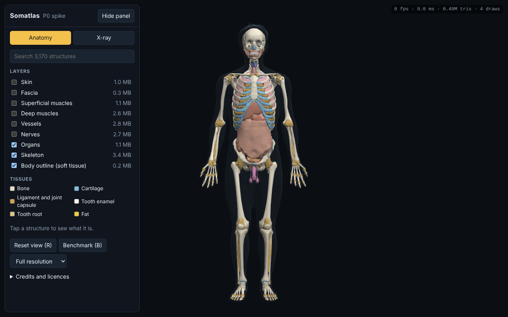
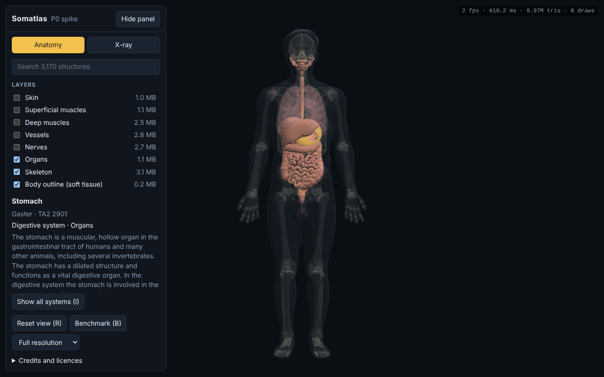
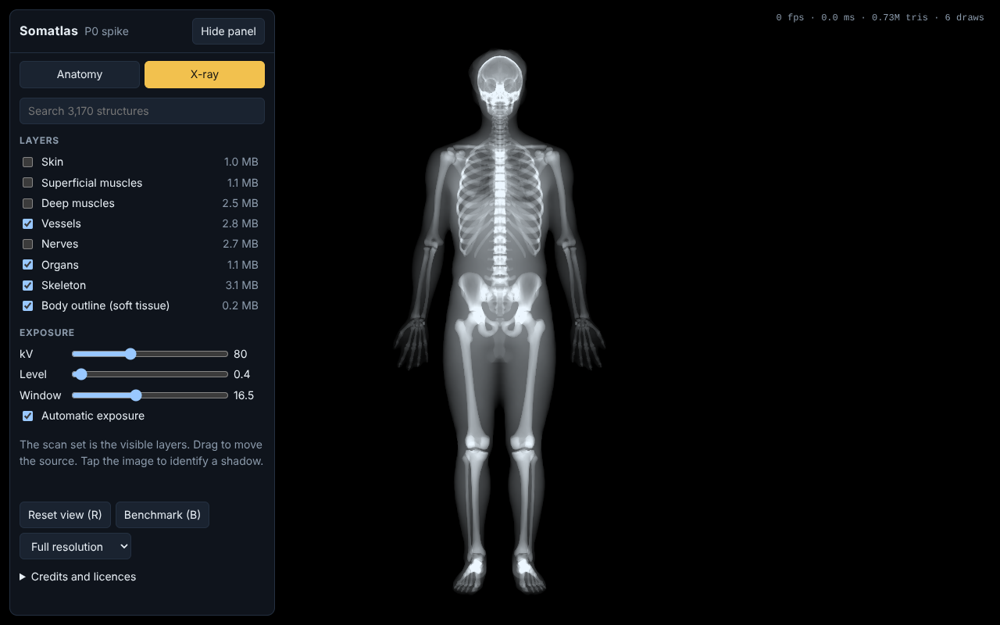
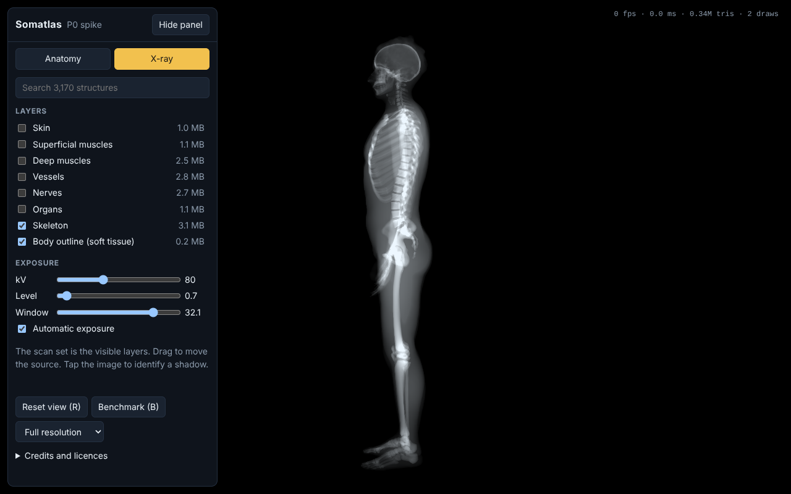

# P0 spike: findings

**Goal (PRD §13):** prove that open anatomy data can drive a layered 3D explorer and a computed X-ray in the browser, at phone frame rates, and decide what the asset pipeline must fix.

**Status:** the spike proves the approach. The first real-device result (an iPhone 12 Pro, from 2020) clears the frame-rate target with every layer on. A mid-range Android phone and the X-ray mode benchmark are still to measure (see [How to test](#how-to-test)).

| Exit criterion | Status |
|---|---|
| 30 fps explorer and X-ray preview on a mid-range phone | **Met on iPhone 12 Pro** for the explorer's worst case: 43 fps average, p95 30 ms (see [Device results](#device-results)). Android and X-ray mode still to measure |
| A mesh repair plan | Done, and the basics are implemented (below) |
| Data source chosen | Z-Anatomy, provisionally. Raw BodyParts3D and the LUMC model were not reachable from the build environment, so they are not compared yet |

## What was built

- **Asset pipeline** ([`pipeline/`](../../pipeline/README.md)). Blender's Python module reads the pinned Z-Anatomy file headlessly, with embedded scripts disabled, and writes per-layer GLB packs, the structure registry and descriptions. meshoptimizer then simplifies and compresses the packs, and CI verifies them against the registry.
- **Explorer.**
  - Layers and orbit controls.
  - Tap to identify, with Latin name, TA2 ID and description.
  - Isolate a system, with the rest ghosted.
  - Search across all structures.
- **Computed X-ray.**
  - Any angle and any scan set (the visible layers).
  - kV control and automatic or manual exposure.
  - Tap the image to list the structures casting that shadow.
- **Define once, derive interfaces.** The registry drives the layers, search, colours, X-ray tissue, credits and pack loading. Every action is a typed operation, and the URL state and keyboard shortcuts are derived from the operation registry (`src/ops.ts`).
- **CI and preview.** Every pull request is type-checked, tested and built. Every push to `main` deploys to GitHub Pages.

| | |
|---|---|
|  |  |
|  |  |

Screenshots come from a headless, software-rendered Chromium, so the frame-rate counter in them is meaningless.

## Findings

### Data

- **3,169 structures** come from Z-Anatomy, and the pipeline generates **3** more (the body outline and two lung volumes).
- **88%** of structures (2,786) match a **Terminologia Anatomica 2** ID, which gives a Latin name for free.
- **77%** (2,433) have a short description from Z-Anatomy's definitions (Wikipedia-derived, CC BY-SA).
- **Vessels and nerves are bevelled curves, not meshes.** At upstream tessellation the 947 curves alone are about 5.1 million triangles. Lighter tessellation (3 segments per curve span, rings of 6 instead of 12) cuts that to 0.65 million. That is a reasonable trade-off for P0, but it needs a close-up visual check.
- **24 structures may come from non-commercial models** (kidney, inner ear and some renal vessels). They are published in separate `*-nc` packs, as the PRD's licensing plan describes. Provenance still needs confirming with the Z-Anatomy authors.
- **13 structures fall back to a "visceral (unassigned)" system**, for example the greater omentum. The mapping in `pipeline/zanatomy.py` needs a few more rules.

Full numbers: [mesh audit](p0/mesh-audit.md).

### Mesh quality for the X-ray

The X-ray works by summing signed distances to front and back faces, so it needs closed, outward-facing meshes.

- **Upstream:** 89% of X-ray-relevant structures are already closed with consistent winding once seam vertices are welded. That includes 94% of bones and 97% of vessels.
- **Mirrored objects.** About half of the paired left/right structures are mirrored copies. Baking their transform turns them inside out, which showed up as a black humerus in the first radiographs. **Fix:** the export orients every closed or nearly closed mesh outwards by its signed volume.
- **Small holes.** Some meshes have a few missing triangles; the humerus, for example, had 4 boundary edges. **Fix:** holes of up to 64 boundary edges are filled on export.
- **No skin surface.** Z-Anatomy's skin is about 250 region patches, not a closed body. **Fix:** `pipeline/hull.py` voxelises the outer anatomy at 4 mm, closes gaps, fills the interior and resurfaces it. The result is a closed body of **78 litres**, a plausible volume for a 1.74 m adult, which becomes the soft-tissue baseline.
- **Open lungs.** The lung lobes are open at the hilum. **Fix:** the same method builds closed lung volumes (1.8 L and 2.1 L) that are used only by the X-ray. That is what makes the lungs appear dark.
- **Simplification breaks strict closedness** for about 20% of soft-tissue and vessel meshes. A mesh is still used if fewer than 0.3% of its edges are defective, because such a defect is a pinhole affecting a few pixels. After repair and simplification, **2,996 of 3,172 structures, including all 277 bones, take part in the X-ray**. The excluded ones are mostly fasciae and other genuinely open sheets.

### Size and performance budget

| | Triangles | Download |
|---|---|---|
| Default view (body outline, skeleton, organs) | 0.48 M | 4.4 MB |
| Everything | 1.50 M | 14.5 MB |

- **Draw calls.** Each pack is merged into one geometry, and a pass is skipped when it has nothing to draw: a hidden layer, a ghost pass with nothing ghosted, or an X-ray pack whose tissue contributes nothing. The default view is 4 draw calls; every layer is 11 in anatomy mode and 5 in X-ray mode. Per-structure state lives in a 64-pixel-wide texture, so showing, hiding, ghosting or selecting never touches geometry.
- **Under budget.** The default view is within the PRD's 5 MB initial-download target.
- **Load time.** In headless Chromium the default view loads in about 3.3 s from a local server. Real-world load time over 4G is still to measure.
- **Registry size.** `registry.json` is 0.98 MB uncompressed. It should be split (core fields now, the rest lazily) before P1.

### Device results

Benchmark: the camera orbits for 8 seconds; "draws" and "triangles" are per frame.

| Device | Browser | View | fps (avg) | p95 frame | Triangles | Draws | Resolution |
|---|---|---|---|---|---|---|---|
| iPhone 12 Pro (A14, 2020) | Safari | Anatomy, every layer | 43.4 | 30.0 ms | 3.00 M | 22 | 856 × 1562 |

That run predates skipping empty passes. It drew every pack twice (the opaque pass plus an always-on ghost pass), so the same view now draws 1.50 M triangles in 11 draws. Expect it to be faster on re-measuring.

### X-ray physics

- **Attenuation data.** NIST mass attenuation coefficients for ICRU-44 tissues, in `src/xray/attenuation.ts`, which is unit-tested.
- **Effective energy.** 40% of kVp.
- **Nested tissue.** With the body outline in the scan set, structures contribute their attenuation relative to soft tissue, so tissue is not counted twice.
- **Precision.** 32-bit float accumulation where `EXT_float_blend` exists, otherwise 16-bit. The stats line shows `fp16` when it falls back.
- **Automatic exposure.** The app meters a 96 × 96 copy of the radiograph a few times a second and sets level and window from what is in the beam. It uses asynchronous readback to avoid GPU stalls. Moving the Level or Window slider switches to manual.

## How to test

Open the preview on the reference devices (a mid-range Android phone, a three-year-old iPhone, and a laptop with integrated graphics):

> <https://bricef.github.io/Somatlas/> (live once this PR is merged and Pages is set to deploy from GitHub Actions)

1. **Default view.** Press **Benchmark** (or B on a keyboard). The camera orbits for 8 seconds and prints the result. Copy the text block.
2. **All layers.** Turn on every layer, then benchmark again.
3. **X-ray.** Switch to X-ray (or X) with the default layers, then benchmark.
4. **If any result is under 30 fps,** set resolution to 75% and repeat.
5. **Visual check.** Tap a few structures, isolate a system, and take an X-ray from an unusual angle.

Paste the benchmark blocks into an issue or a PR comment. They include fps, p95 frame time, triangles, draw calls, resolution and GPU name.

Useful URLs (everything is shareable):

- Lateral X-ray with soft tissue: `?m=xray&l=hull,skeleton&c=3.2,0.95,0,0,0.88,0`
- Everything visible: `?l=hull,muscles-deep,muscles-superficial,nerves,organs,skeleton,skin,vessels`

## Known gaps and next steps

1. **Measure on phones.** If they fall short, lower the per-layer simplification ratios in `pipeline/optimize.mjs`, add a second level of detail, or render the X-ray at reduced resolution.
2. **Picking on phones.** The first tap builds a bounding-volume hierarchy (BVH) for the loaded packs. Time it on a phone; it may need to move to a worker or be precomputed.
3. **Battery.** Rendering is continuous for honest frame-rate numbers. Switch to on-demand rendering after P0.
4. **Compare data sources.** Raw BodyParts3D and the LUMC Open 3D model. This needs a manual download, because they weren't reachable from the build environment.
5. **Finish the system mapping** (the 13 unassigned structures) and confirm the provenance of the non-commercial structures.
6. **Split the registry** and lazy-load the descriptions per structure.
7. **Repo growth.** Re-exports rewrite about 15 MB of binaries in git. Consider Git LFS or publishing packs as release assets before assets change often.
